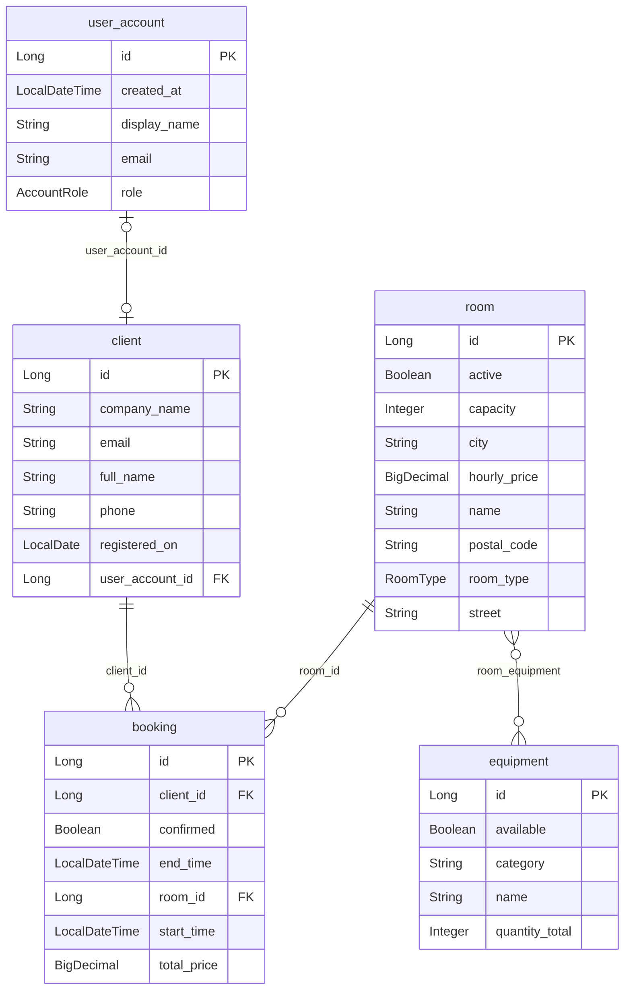

# Schemat bazy danych

Plik generują reguły projektu (panel Maven → Lifecycle → verify). Nie edytujcie go ręcznie.

Tabele: 6 (w tym tabele łączące @ManyToMany: room_equipment) · kolumny: 33 · relacje: 2 × @ManyToOne, 2 × @OneToMany, 1 × @OneToOne, 1 × @ManyToMany

| Tabela | Encja | Kolumny | Klucze obce |
|---|---|---|---|
| booking | Booking | 7 | client_id, room_id |
| client | Client | 7 | user_account_id |
| equipment | Equipment | 5 | — |
| room | Room | 9 | — |
| user_account | UserAccount | 5 | — |

